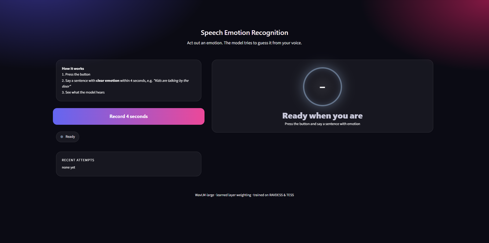

# Speech Emotion Recognition

**Speak into your microphone and see which emotion the model hears in your voice.**



## What is this?

This project listens to a few seconds of speech and guesses the emotion behind it: **angry, disgust, fear, happy, neutral, sad or surprise**.

It does not care *what* you say, only *how* you say it: the pitch, rhythm, tension and sound of your voice. Think of it as a mood meter for voices. Everything runs on your own computer, and there is a small web page where you can try it live.

## Try it

1. Open the app and press **Record**.
2. Say a sentence with a clear emotion for about 4 seconds, for example *"Kids are talking by the door"* said angrily, happily or sadly.
3. The app shows the most likely emotion and how confident the model is for each of the seven emotions.

If the model is not confident (below 50 percent), the app says "Not sure" instead of guessing. Recordings that are too quiet are rejected with a hint to move closer to the microphone.

## How well does it work?

On actors the model has never heard during training, it recognizes the right emotion in about **81 percent** of the clips (macro-F1 0.81; random guessing would give about 14 percent).

| Emotion | angry | disgust | fear | happy | neutral | sad | surprise |
|---|---|---|---|---|---|---|---|
| F1 score | 0.83 | 0.90 | 0.68 | 0.75 | 0.84 | 0.80 | 0.85 |

Fear is the hardest emotion: the model is usually right when it says "fear", but misses almost half of the fear clips. These numbers come from 260 test clips of 5 actors (RAVDESS), so treat differences of a few points as noise. The training and test data are **acted, English, studio-quality speech**; expect lower accuracy with your own voice, other languages and ordinary microphones.

## Run it yourself

You need Python 3.10 or newer and a microphone. A GPU is optional.

### 1. Install

```bash
git clone https://github.com/RonaldCrack10/Speech_Emotion_Recognition.git
cd Speech_Emotion_Recognition
uv sync        # or: python -m venv .venv && pip install -r requirements.txt
```

For GPU support, install the CUDA build of PyTorch that matches your driver (see pytorch.org).

### 2. Get a trained model

The trained model is too large for GitHub and is not part of the repository. Either:

- **Use the pretrained checkpoint:** download link to be added, then place the file at `checkpoints/ser.pt`.
- **Train it yourself:** see [Train it yourself](#train-it-yourself) below. It takes under an hour on a CPU plus a few minutes of training.

### 3. Start the app

```bash
uv run src/app.py
```

Open `http://127.0.0.1:7860` in your browser, press **Record**, and speak. The first start downloads the speech model (about 1 GB) and takes a little longer.

The app records through the microphone of the computer it runs on, so run it on the machine you are speaking into.

### Train it yourself

1. **Download the data** and unpack it under `data/raw/`:
   - [RAVDESS](https://zenodo.org/records/1188976) (speech)
   - [TESS](https://tspace.library.utoronto.ca/handle/1807/24487)

   Then set the two folder paths (`ravdess_path`, `tess_path`) at the top of `src/data.py`.
2. **Check the data:**
   ```bash
   uv run src/data.py          # prints how many clips go into train, val and test
   ```
3. **Compute the speech features once** (about 20 minutes on a CPU, a few minutes on a GPU):
   ```bash
   uv run src/extract.py
   ```
4. **Train the classifier** (seconds per epoch):
   ```bash
   uv run src/training.py         # saves checkpoints/ser.pt
   ```
5. **Measure it on the test actors:**
   ```bash
   uv run src/evaluation.py    # accuracy, per-emotion scores, confusion matrix
   ```

If something goes wrong:

- *"Too quiet" message:* raise the microphone input volume in your system settings or move closer.
- *Nothing is recorded or the wrong microphone is used:* choose the right default input device in your system sound settings.
- *Slow predictions:* without a GPU a prediction takes a few seconds. That is normal.

1. **Clean up the audio:** resample to 16 kHz, cut silence at the start and end, and fit it to exactly 4 seconds at a fixed loudness.
2. **Describe how it sounds:** a pretrained speech model (WavLM) turns the audio into lists of numbers. Its layers describe the voice at different levels of abstraction. This model is **frozen**, we do not retrain it.
3. **Classify the emotion:** a small neural network, trained on emotional speech recordings, maps those numbers to the seven emotions. Instead of using only the last layer of WavLM, it **learns how much to trust each layer**. The middle layers turned out to carry the most emotion information, and this alone raised the test macro-F1 from 0.57 to 0.81.

Because the speech model never changes, its output for each training clip is computed **once** and stored (`src/extract.py`). Training the classifier then takes seconds per epoch instead of about 18 minutes.

The same preprocessing and the same feature code are used for training and for the live microphone, so the model sees at runtime what it saw during training.

## Project structure

```
src/
  data.py         read and label the datasets, split by speaker, prepare audio
  extract.py      compute and store WavLM features for every clip (run once)
  training.py        train the emotion classifier on the stored features
  evaluation.py   test-set metrics and confusion matrix
  live.py         prediction pipeline and microphone recording
  app.py          the web page (Gradio)
  model.py        end-to-end variant using only the last WavLM layer
checkpoints/      trained models (not in git)
data/             datasets and stored features (not in git)
results/          metrics and plots
docs/             screenshots for this README
```

## Data and evaluation setup

| Dataset | Clips used | Speakers | Notes |
|---|---|---|---|
| RAVDESS (speech) | 1,248 | 24 actors | the emotion "calm" is left out |
| TESS | 2,800 | 2 | "pleasant surprise" counts as surprise |

The split is **by speaker**, so the model is always tested on voices it has never heard:

| Split | Data | Clips |
|---|---|---|
| Train | RAVDESS actors 1 to 14 and all of TESS | 3,528 |
| Validation | RAVDESS actors 15 to 19 | 260 |
| Test | RAVDESS actors 20 to 24 | 260 |

TESS has only two speakers and is used for training only. The datasets are not included here; check their licenses before reuse (RAVDESS: CC BY-NC-SA 4.0, TESS: CC BY-NC-ND 4.0).

## Limitations and next steps

- Trained on acted, English speech. Real conversations, other languages and noisy rooms are harder.
- Only a few speakers, and a single training run without confidence intervals.
- Not yet evaluated on a second dataset.
- Planned: results for the larger WavLM model, own recordings from several speakers, fine-tuning on a GPU, continuous live prediction with smoothing, and unit tests.

## Credits

- S. Chen et al., *WavLM: Large-Scale Self-Supervised Pre-Training for Full Stack Speech Processing*, IEEE JSTSP, 2022
- S. Yang et al., *SUPERB: Speech processing Universal PERformance Benchmark*, Interspeech, 2021 (learned weighting of layers)
- S. R. Livingstone and F. A. Russo, *The Ryerson Audio-Visual Database of Emotional Speech and Song (RAVDESS)*, PLoS ONE, 2018
- M. K. Pichora-Fuller and K. Dupuis, *Toronto emotional speech set (TESS)*, University of Toronto, 2020

## License

Apache License 2.0
